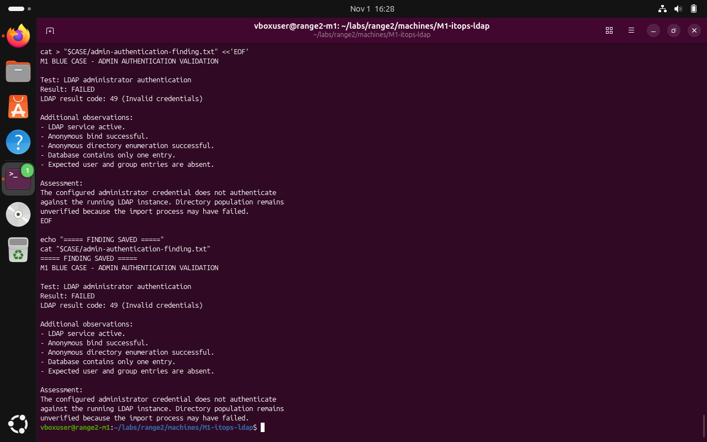
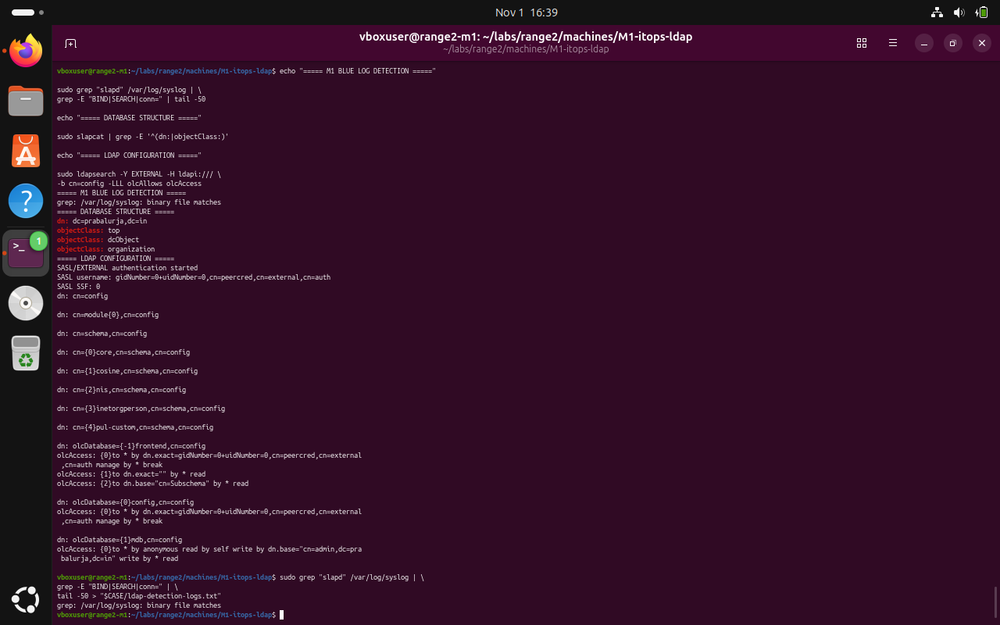
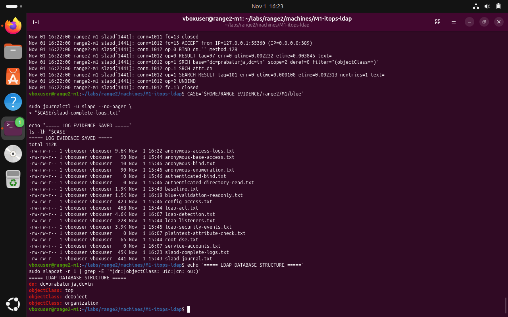

# M1 — LDAP directory service: Blue Team — validation and remediation

**Submission note:** The following are screenshots from the Range 2 lab conversation. They support the specific observations described; an instruction recorded in a challenge file is not proof that an attack was performed.

The service was observed active, but the directory contained only a base entry. The attempted administrator authentication returned invalid credentials. Treat directory population and administrator access as unresolved.

## 1. Verify the failed administrator authentication finding

```bash
CASE="$HOME/RANGE-EVIDENCE/range2/M1/blue"
cat "$CASE/admin-authentication-finding.txt"
```



*Evidence BLUE-01: The recorded finding documents LDAP result 49 and the missing intended entries.*

## 2. Review access rules and LDAP diagnostic output

```bash
sudo ldapsearch -Y EXTERNAL -H ldapi:/// -b cn=config -LLL olcAccess olcSuffix
```



*Evidence BLUE-02: Configuration and access-related entries were inspected; remediation was not confirmed.*

## 3. Check the evidence collection and directory structure

```bash
CASE="$HOME/RANGE-EVIDENCE/range2/M1/blue"
ls -lh "$CASE"
sudo slapcat -n 1 | grep -E "^(dn:|objectClass:)"
```



*Evidence BLUE-03: Evidence files were collected and the live directory structure was checked.*

## Recommended next actions

- Investigate and correct the directory import failure before relying on directory-user or group tests.
- Validate the administrator bind credential using a protected test and rotate affected credentials if exposed.
- Review anonymous search permissions and retain slapd audit logs.
- Repeat authenticated directory and group tests after population succeeds.

**Completion assessment:** Local verification performed; remediation acceptance testing remains pending unless explicitly evidenced above.
