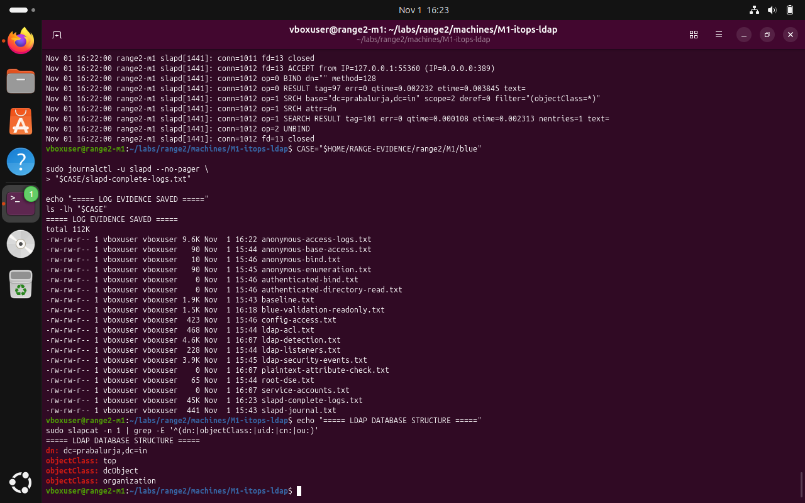
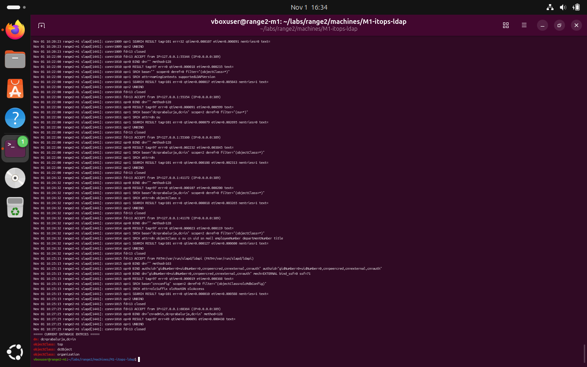

# M1 — LDAP directory service: Red Team — documented observations

**Submission note:** The following are screenshots from the Range 2 lab conversation. They support the specific observations described; an instruction recorded in a challenge file is not proof that an attack was performed.

The supplied challenge narrative describes potential LDAP discovery and access-control weaknesses. The demonstrated commands below are read-only local observations; successful compromise is not established.

## 1. Inspect the visible LDAP directory structure

```bash
sudo slapcat -n 1 | grep -E '^(dn:|objectClass:)'
```



*Evidence RED-01: Output showed the base directory entry, not the intended collection of user and group objects.*

## 2. Review LDAP connection and search events

```bash
sudo journalctl -u slapd --no-pager | grep -E 'SRCH|BIND|RESULT' | tail -n 40
```



*Evidence RED-02: The journal showed anonymous bind and search activity; log visibility alone does not establish unauthorized access.*

## Scope limitation

This document does not claim successful credential extraction or lateral movement based only on the supplied red-team narrative. Secrets and potentially sensitive artifacts are intentionally excluded.
