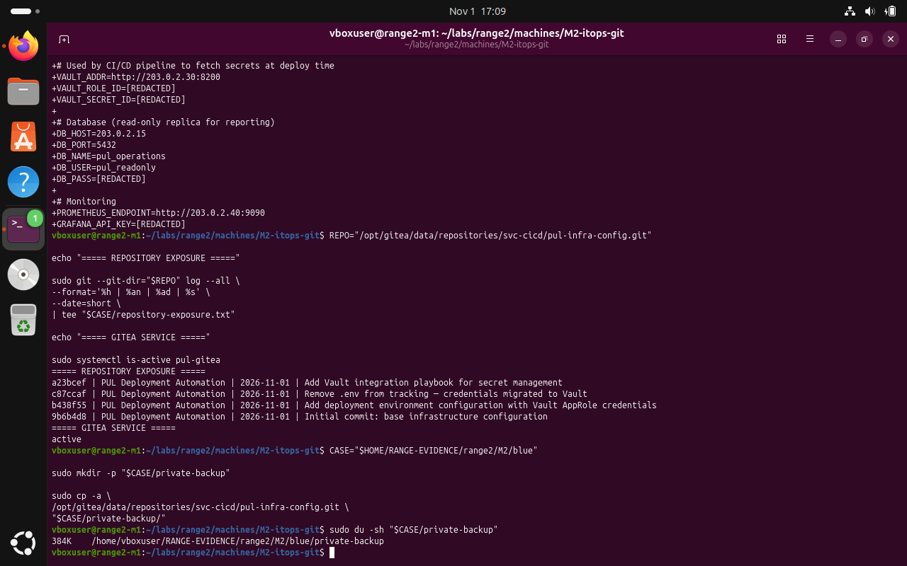
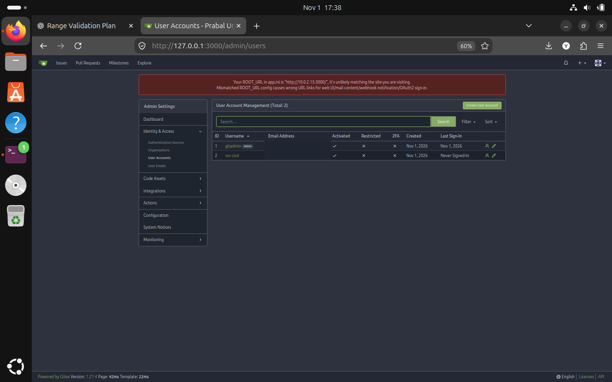
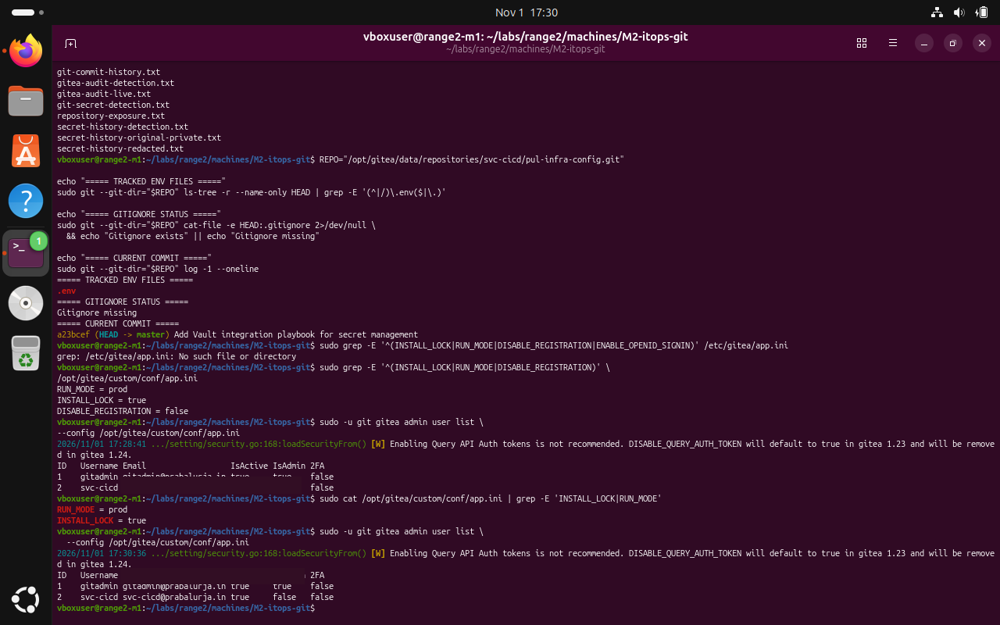

# M2 — Gitea source control: Blue Team — validation and remediation

**Submission note:** The following are screenshots from the Range 2 lab conversation. They support the specific observations described; an instruction recorded in a challenge file is not proof that an attack was performed.

Repository history, current tracking status and account-management state were examined. A current-tree change does not erase past Git commits, so any previously exposed secrets still require rotation.

## 1. Check Gitea service and the repository's audit timeline

```bash
sudo systemctl is-active pul-gitea
REPO="/opt/gitea/data/repositories/svc-cicd/pul-infra-config.git"
sudo git --git-dir="$REPO" log --all --oneline
```



*Evidence BLUE-01: The service was active and four commits were listed.*

## 2. Review administrative account status

```bash
# In the already-authenticated local Gitea admin UI:
# Identity & Access → User Accounts
```



*Evidence BLUE-02: The local administrative screen listed gitadmin and svc-cicd. Account emails are masked in this public version.*

## 3. Review repository tracking and application configuration

```bash
REPO="/opt/gitea/data/repositories/svc-cicd/pul-infra-config.git"
sudo git --git-dir="$REPO" ls-tree -r --name-only HEAD | grep -E "(^|/)\.env$" || true
```



*Evidence BLUE-03: The check identifies a tracked .env in the current tree; policy and rotation work were not validated as complete.*

## Recommended next actions

- Remove secrets from active files and rotate any values committed historically.
- Assess and, if approved, rewrite affected Git history with backups; coordinate with repository users.
- Set repository visibility and permissions to least privilege.
- Enable appropriate audit retention and require multi-factor authentication for administrators.

**Completion assessment:** Local verification performed; remediation acceptance testing remains pending unless explicitly evidenced above.
