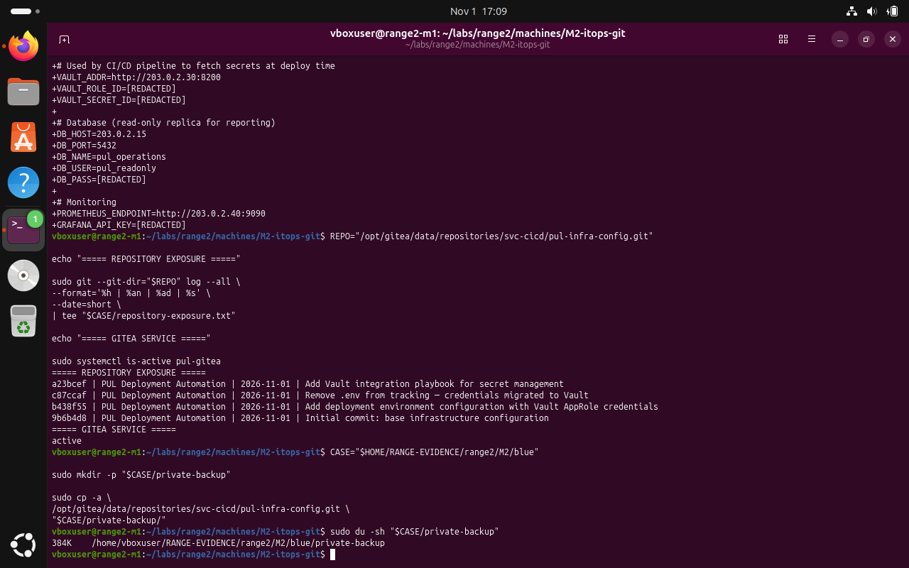
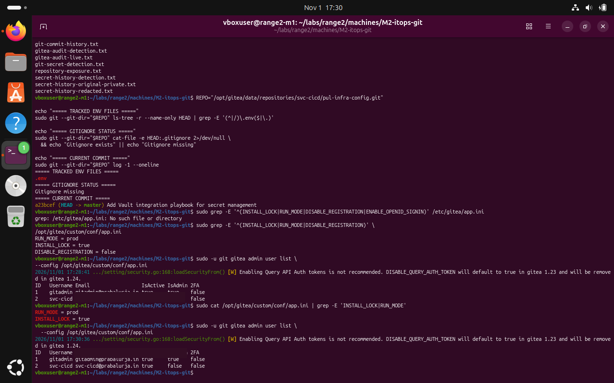

# M2 — Gitea source control: Red Team — documented observations

**Submission note:** The following are screenshots from the Range 2 lab conversation. They support the specific observations described; an instruction recorded in a challenge file is not proof that an attack was performed.

The supplied lab scenario describes historical secret exposure through source-control history. The screenshots support repository-history visibility; they do not prove that exposed material was abused.

## 1. Review the repository commit history

```bash
REPO="/opt/gitea/data/repositories/svc-cicd/pul-infra-config.git"
sudo git --git-dir="$REPO" log --all --oneline
```



*Evidence RED-01: Historical commits described initial configuration, deployment environment addition and later removal from tracking.*

## 2. Check whether an environment file remains in the latest tree

```bash
REPO="/opt/gitea/data/repositories/svc-cicd/pul-infra-config.git"
sudo git --git-dir="$REPO" ls-tree -r --name-only HEAD | grep -E "(^|/)\.env$" || true
```



*Evidence RED-02: The documented check showed an environment file in the current Git tree in this local lab observation; source-tree state must be treated separately from Git history.*

## Scope limitation

This document does not claim successful credential extraction or lateral movement based only on the supplied red-team narrative. Secrets and potentially sensitive artifacts are intentionally excluded.
