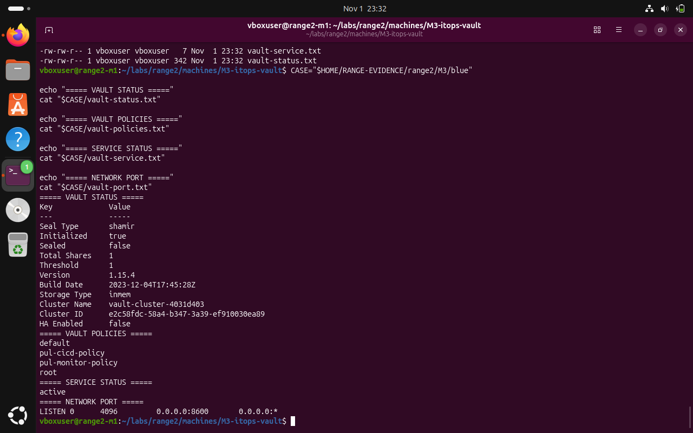
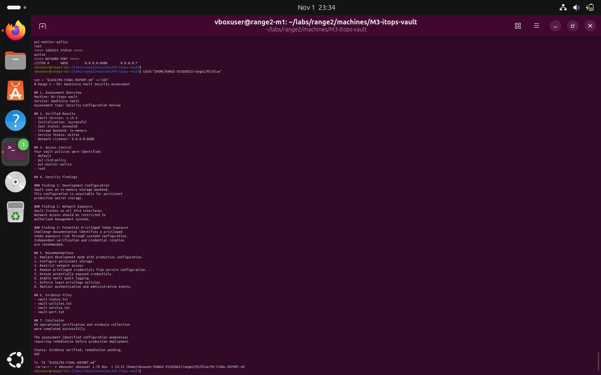

# M3 — HashiCorp Vault: Blue Team — validation and remediation

**Submission note:** The following are screenshots from the Range 2 lab conversation. They support the specific observations described; an instruction recorded in a challenge file is not proof that an attack was performed.

Operational validation succeeded, but using an in-memory backend and wide listener is inappropriate for production. Credential revocation, audit logging and hardening were recommended rather than demonstrated.

## 1. Review the configured policies

```bash
vault policy list
```



*Evidence BLUE-01: Policy names included default, root, pul-cicd-policy and pul-monitor-policy. No secret values are reproduced.*

## 2. Verify captured operational evidence

```bash
CASE="$HOME/RANGE-EVIDENCE/range2/M3/blue"
cat "$CASE/vault-status.txt"
cat "$CASE/vault-service.txt"
cat "$CASE/vault-port.txt"
```


*Evidence BLUE-02: The saved files matched the service state and the port check.*

## 3. Verify the M3 security assessment Markdown was written

```bash
CASE="$HOME/RANGE-EVIDENCE/range2/M3/blue"
ls -lh "$CASE/M3-FINAL-REPORT.md"
```



*Evidence BLUE-03: The report existed locally; its remediation tasks were recorded as pending.*

## Recommended next actions

- Replace development mode with a hardened service deployment and durable storage.
- Bind the listener only to authorized interfaces or protect it with network access controls and TLS.
- Remove privileged tokens from unit files and logs; rotate all exposed tokens.
- Enable audit devices and verify AppRole scopes and policy least privilege.

**Completion assessment:** Local verification performed; remediation acceptance testing remains pending unless explicitly evidenced above.
