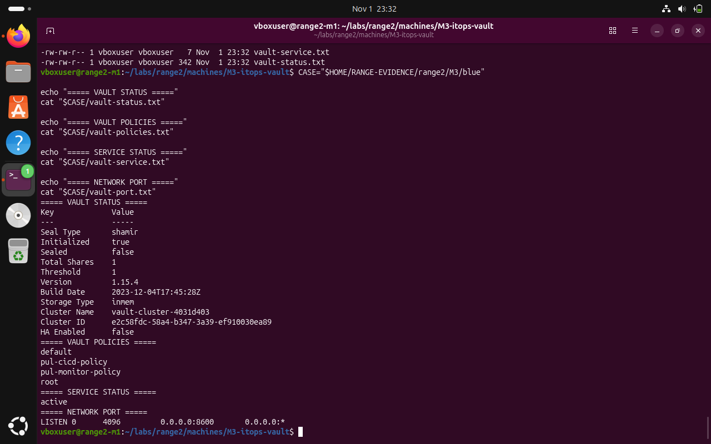

# M3 — HashiCorp Vault: Red Team — documented observations

**Submission note:** The following are screenshots from the Range 2 lab conversation. They support the specific observations described; an instruction recorded in a challenge file is not proof that an attack was performed.

The challenge narrative warns about development-mode and privileged token exposure. No screenshot of a plaintext token is included in this public package. We confirmed the dangerous configuration indicators, not a successful pivot.

## 1. Inspect the Vault status and listener

```bash
vault status
ss -ltn | grep ":8600"
```



*Evidence RED-01: Vault was unsealed, had an in-memory backend and listened on 0.0.0.0:8600.*

## Scope limitation

This document does not claim successful credential extraction or lateral movement based only on the supplied red-team narrative. Secrets and potentially sensitive artifacts are intentionally excluded.
