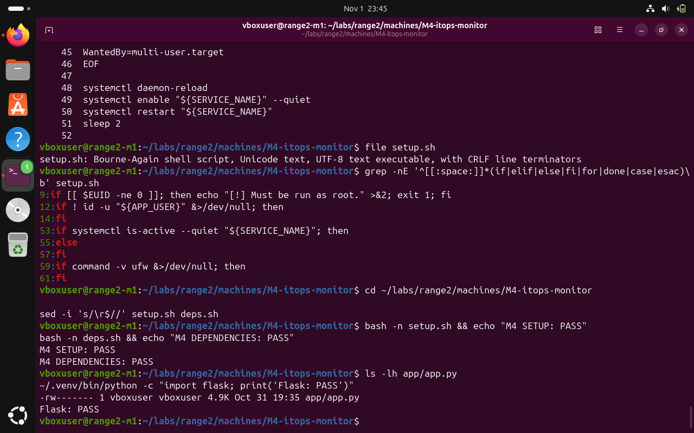
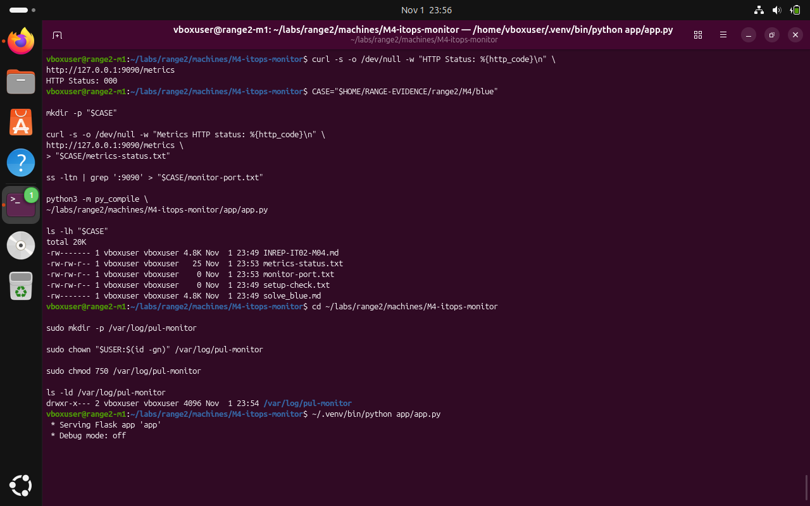
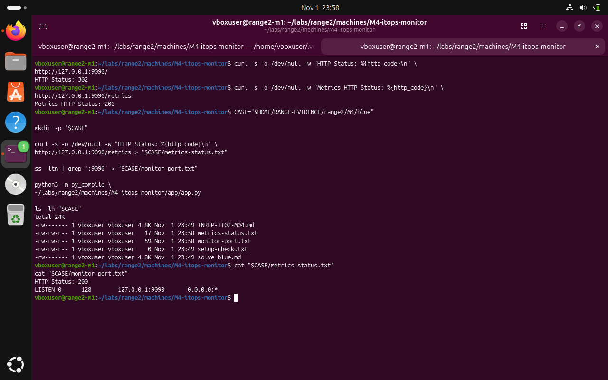

# M4 — Monitoring portal: Blue Team — validation and remediation

**Submission note:** The following are screenshots from the Range 2 lab conversation. They support the specific observations described; an instruction recorded in a challenge file is not proof that an attack was performed.

The monitoring portal was started and local /metrics response recorded. Local-only binding reduced network exposure in the test instance but did not implement authentication or remove sensitive metrics labels.

## 1. Confirm the setup script line-ending issue and subsequent syntax fix

```bash
file setup.sh
sed -i "s/\r$//" setup.sh deps.sh
bash -n setup.sh && echo "M4 SETUP: PASS"
bash -n deps.sh && echo "M4 DEPENDENCIES: PASS"
```



*Evidence BLUE-01: CRLF was identified as the cause of shell parsing errors; both scripts then passed syntax checks.*

## 2. Start the loopback-bound Flask test application

```bash
~/.venv/bin/python app/app.py
```



*Evidence BLUE-02: After creating the log directory with suitable permissions, Flask started in the local VM.*

## 3. Save and review metrics and listening-port evidence

```bash
CASE="$HOME/RANGE-EVIDENCE/range2/M4/blue"
cat "$CASE/metrics-status.txt"
cat "$CASE/monitor-port.txt"
```



*Evidence BLUE-03: The saved endpoint check returned HTTP 200 and the listener was 127.0.0.1:9090.*

## Recommended next actions

- Require appropriate authentication on /metrics and protect monitoring routes.
- Remove passwords, credentials and secrets from metric label values.
- Apply rate limits, audit logging and appropriate network controls.
- Retest after remediation: a public no-auth metrics request should not return sensitive data.

**Completion assessment:** Local verification performed; remediation acceptance testing remains pending unless explicitly evidenced above.
