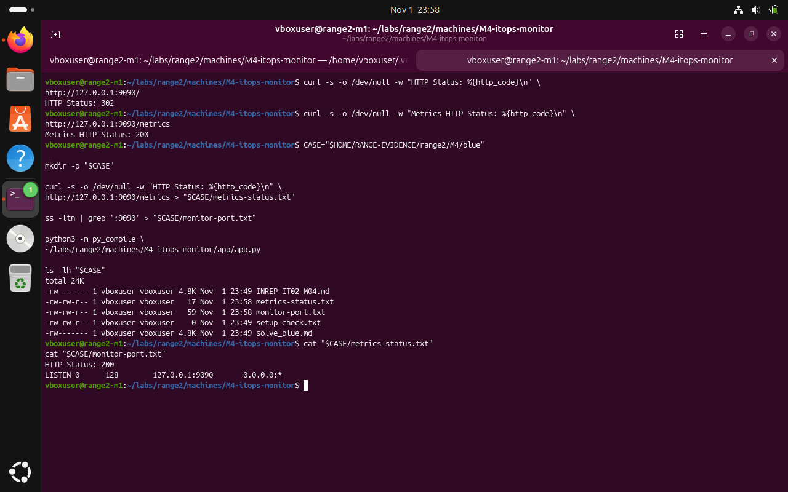

# M4 — Monitoring portal: Red Team — documented observations

**Submission note:** The following are screenshots from the Range 2 lab conversation. They support the specific observations described; an instruction recorded in a challenge file is not proof that an attack was performed.

The lab scenario describes an unauthenticated metrics endpoint with sensitive labels. Our read-only local check confirmed /metrics was accessible but did not publish its raw content or extract credentials.

## 1. Review monitoring endpoint reachability without downloading metrics content

```bash
curl -s -o /dev/null -w "Metrics HTTP Status: %{http_code}\n" http://127.0.0.1:9090/metrics
```



*Evidence RED-01: The unauthenticated HTTP request returned 200 for /metrics on the loopback-bound test instance.*

## Scope limitation

This document does not claim successful credential extraction or lateral movement based only on the supplied red-team narrative. Secrets and potentially sensitive artifacts are intentionally excluded.
