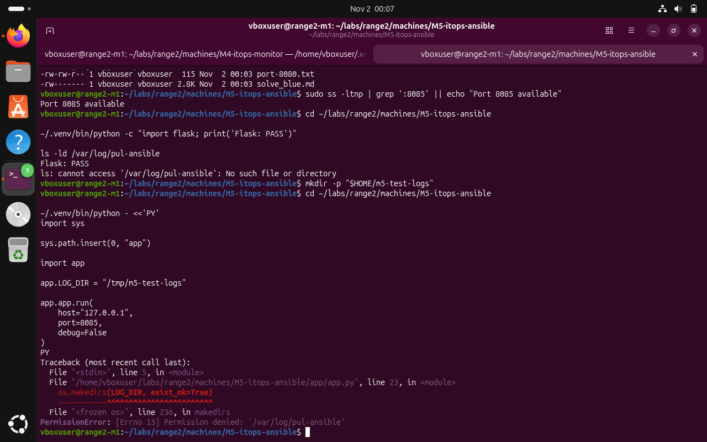
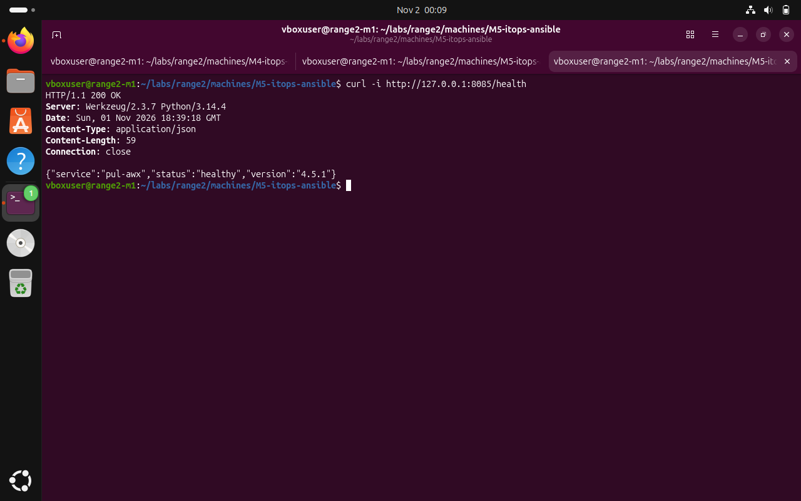
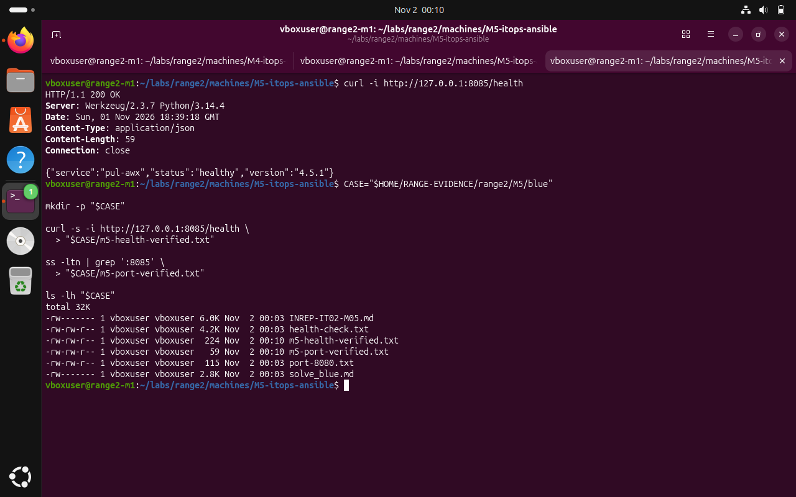
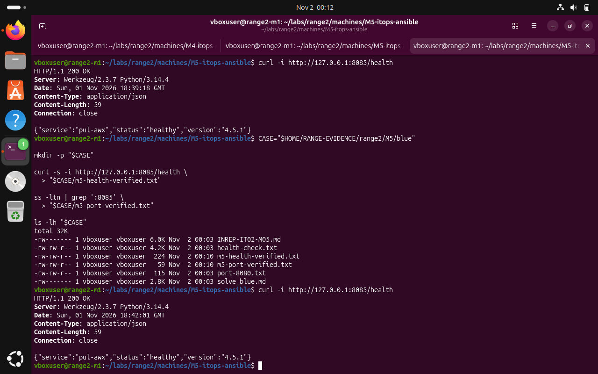

# M5 — Ansible AWX-style portal: Blue Team — validation and remediation

**Submission note:** The following are screenshots from the Range 2 lab conversation. They support the specific observations described; an instruction recorded in a challenge file is not proof that an attack was performed.

A local M5 instance was confirmed healthy at 127.0.0.1:8085. This does not establish that the original pul-awx systemd unit was installed or that access-control issues were remediated.

## 1. Check dependencies and the application startup issue

```bash
~/.venv/bin/python -c "import flask; print('Flask: PASS')"
ls -ld /var/log/pul-ansible
```



*Evidence BLUE-01: Flask was available; the required system log directory was initially missing or inaccessible.*

## 2. Validate the local health endpoint

```bash
curl -i http://127.0.0.1:8085/health
```



*Evidence BLUE-02: HTTP 200 returned a JSON object with service pul-awx, healthy status and application version 4.5.1.*

## 3. Verify the M5 evidence files were saved

```bash
CASE="$HOME/RANGE-EVIDENCE/range2/M5/blue"
ls -lh "$CASE"
```



*Evidence BLUE-03: Health and port verification text files were present in the local evidence directory.*

## 4. Repeat the health check to confirm stable local availability

```bash
curl -i http://127.0.0.1:8085/health
```



*Evidence BLUE-04: The repeated local request again returned HTTP 200 and status healthy.*

## Recommended next actions

- Require authorization checks for job-output and artifact access, including direct-object requests.
- Scrub credentials from logs, deployment outputs and stored job artifacts.
- Document proper systemd installation and test behind an authenticated interface.
- Review role-based access control, session security and audit retention.

**Completion assessment:** Local verification performed; remediation acceptance testing remains pending unless explicitly evidenced above.
