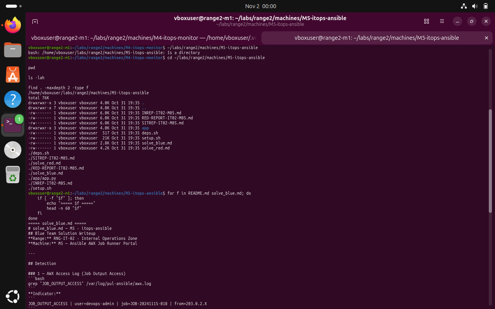

# M5 — Ansible AWX-style portal: Red Team — documented observations

**Submission note:** The following are screenshots from the Range 2 lab conversation. They support the specific observations described; an instruction recorded in a challenge file is not proof that an attack was performed.

The M5 narrative describes job-output and file-browsing exposure risks, but the demonstrated evidence here is primarily operational. No authenticated exploitation, credentials extraction or pivot is asserted.

## 1. Inspect the M5 lab's available files and stated detection scope

```bash
cd ~/labs/range2/machines/M5-itops-ansible
find . -maxdepth 2 -type f
head -n 25 solve_blue.md
```



*Evidence RED-01: The M5 package includes the blue-team description of access to AWX job-output logs. This is scenario context, not observed data theft.*

## Scope limitation

This document does not claim successful credential extraction or lateral movement based only on the supplied red-team narrative. Secrets and potentially sensitive artifacts are intentionally excluded.
